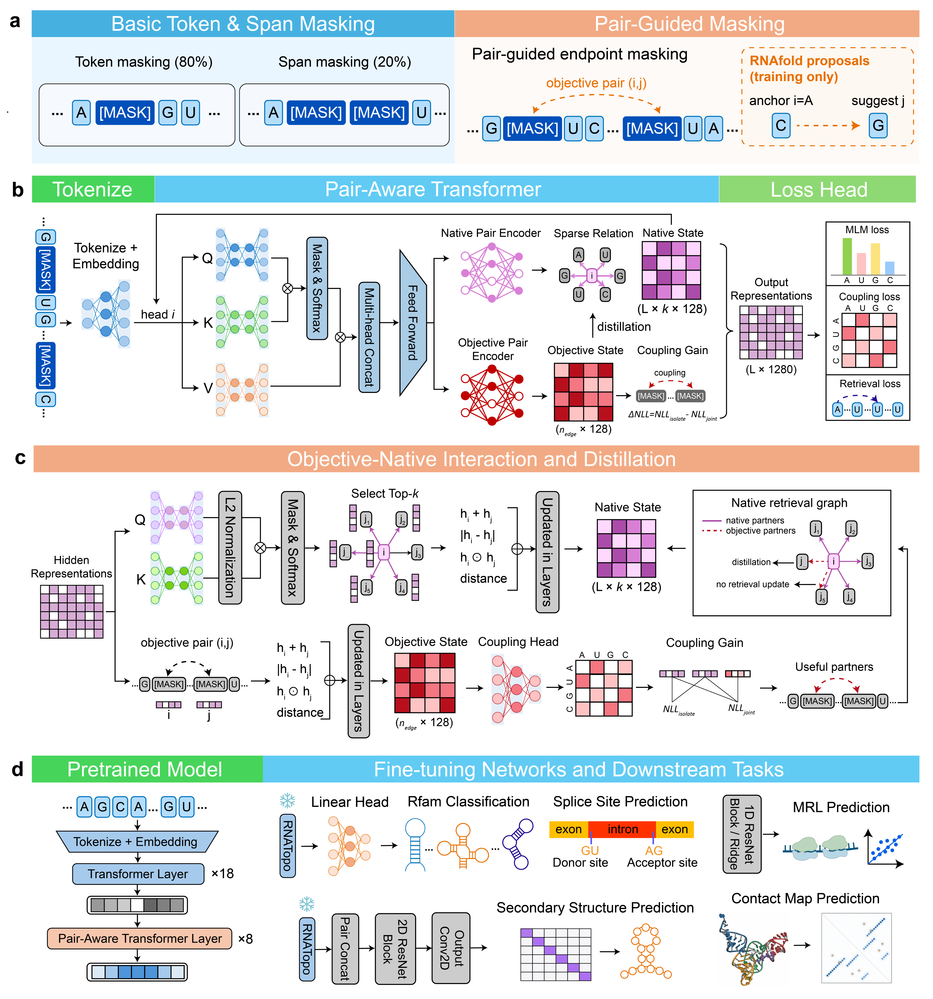

# RIPPLE

RIPPLE is a sequence-only RNA pretrained model. Training combines three losses on the same encoder:

- token and span masked language modeling
- a 16-way joint endpoint objective
- gain-distilled candidate retrieval

The encoder is a RoPE Transformer. A sparse pair state is created at an upper layer, updated after each later layer, and added back to token attention through a bounded residual. Retrieval query and key projections use one constant learning rate, `--retrieval_qk_lr`.




## Installation

The tested stack is Python 3.11 and PyTorch 2.9.0 built for CUDA 12.8. GPU training needs an NVIDIA driver that supports CUDA 12.8. A CPU machine can still load the model and extract embeddings.

Create a Conda environment:

```bash
conda create -n ripple python=3.11 -y
conda activate ripple
python -m pip install -U pip
```

Or use a virtual environment when Conda is not available:

```bash
python3.11 -m venv .venv
source .venv/bin/activate
python -m pip install -U pip
```

Install this repository from its root. `requirements.txt` pulls `torch==2.9.0+cu128` from the PyTorch wheel index and the remaining packages from PyPI:

```bash
pip install -r requirements.txt
```

Check that the CUDA build is the one that was installed, then import the local package. Run the check from this directory:

```bash
python -c "import torch; print(torch.__version__, torch.cuda.is_available())"
python -c "from model.core.tokenizer import RNATokenizer; print(RNATokenizer().encode('AUCG'))"
```

The first line should print `2.9.0+cu128` and `True` on a GPU machine. `False` means PyTorch cannot see a GPU; training would fall back to CPU.

For a machine without a GPU, comment out `torch==2.9.0+cu128` in `requirements.txt`, then install the CPU wheel and the remaining packages:

```bash
pip install torch==2.9.0 --index-url https://download.pytorch.org/whl/cpu
pip install -r requirements.txt
```

Leaving the CUDA pin uncommented makes the second command replace the CPU wheel.

`attention_backend=auto` uses PyTorch's packed variable-length FlashAttention for CUDA FP16/BF16 and scaled dot-product attention otherwise. Other backends are `manual`, `cudnn_sdpa`, and `varlen_flash`. RIPPLE does not need the separate `flash-attn` package.

`downstream/head/` can load external encoders. Those imports are optional and are commented at the bottom of `requirements.txt`. Uncomment `transformers`, `tokenizers`, and `timm` only when using those loaders. HydraRNA additionally needs its own fairseq checkout, `flash-attn`, and `mamba-ssm`, which are not part of this install. Pretraining and the embedding example do not import them.

## Data

Training, validation, and structure monitors are three-line fold files. `T` is read as `U`. A record is kept when the sequence and structure have the same length, the length is from 8 through `max_seq_length - 2` (1024 with the default 1026), and every base is `A`, `U`, `C`, `G`, or `N`.

```
>example
GGCGAUAUAGCUCAGUUGG
((((...(((....)))))))
```

The trainer writes `<train.fold>.offsets.mb<max_bases>.u64` beside the training file and skips that scan on later runs. Sequences that also appear in the validation fold, structure monitors, or downstream files under `--downstream_data_root` are removed from training.

## Training

Run from this directory:

```bash
python model/training/pretrain/run_persistent_pair_state_pretrain.py \
  --sequence_train_path data/train.fold \
  --sequence_valid_path data/valid.fold \
  --output_dir output/ripple \
  --disable_downstream_monitor
```

Two GPUs:

```bash
torchrun --nproc_per_node=2 \
  model/training/pretrain/run_persistent_pair_state_pretrain.py \
  --sequence_train_path data/train.fold \
  --sequence_valid_path data/valid.fold \
  --output_dir output/ripple \
  --disable_downstream_monitor
```

A short CPU or GPU check:

```bash
python model/training/pretrain/run_persistent_pair_state_pretrain.py \
  --sequence_train_path data/train.fold \
  --sequence_valid_path data/valid.fold \
  --output_dir output/smoke \
  --smoke \
  --disable_downstream_monitor
```

`--smoke` shrinks the model and runs three steps. It does not check the 400M–600M parameter guard.

## Default model

| Item | Value |
| --- | --- |
| Layers / hidden / heads | 26 / 1280 / 20 |
| Intermediate size | 5120 |
| Pair state starts at layer | 18 |
| Pair dimension / heads | 128 / 4 |
| Candidates / forced slots | 8 / 2 |
| Residual cap | 0.006 |
| Pair loss weight | 0.1 |
| Retrieval loss weight | 0.02 |
| Retrieval Q/K learning rate | 1e-6 |
| Backbone learning rate | 1e-4, 2% warmup, cosine decay |
| Masking | 15% tokens; 20% of sequences use spans of mean length 4 |
| Max steps | 1,500,000 |

Full training must land between 400M and 600M parameters. Pair, retrieval, and residual weights warm up from zero; the step bounds are CLI flags. `--length_edge_schedule by_length` uses 16, 24, 32, or 40 objective edges for lengths below 256, 384, 512, and at or above 512.

`--resume_from` restores weights and `trainer_state.pt`. `--init_from` loads weights only. Each checkpoint directory contains `config.json`, `pytorch_model.bin`, and `vocab.txt`. Pass `--checkpoint_weights_only` to keep optimizer state only on the newest checkpoint.

## Embeddings

Put a checkpoint in `model/weights/`: `config.json` and `pytorch_model.bin`. The tokenizer is built in code and does not read `vocab.txt`. Run the snippet below from this directory. `T` is converted to `U`. A sequence longer than `max_position_embeddings - 2` must be truncated before `encode`.

```python
import torch

from model.core.persistent_pair_state_mlm import (
    PersistentPairStateEncoderAdapter,
    PersistentPairStateForMaskedLM,
)
from model.core.tokenizer import PAD_ID, RNATokenizer

device = torch.device("cuda" if torch.cuda.is_available() else "cpu")
model = PersistentPairStateForMaskedLM.from_pretrained(
    "model/weights", map_location=device
)
model.to(device).eval()
encoder = PersistentPairStateEncoderAdapter(model)

sequence = "GGCGAUAUAGCUCAGUUGG".replace("T", "U")
ids = torch.tensor([RNATokenizer().encode(sequence)], dtype=torch.long, device=device)
attention = (ids != PAD_ID).long()

with torch.inference_mode():
    hidden = encoder(input_ids=ids, attention_mask=attention)
    bases = hidden[:, 1:-1]  # [1, sequence length, hidden]
    mask = attention.unsqueeze(-1).to(hidden.dtype)
    pooled = (hidden * mask).sum(1) / mask.sum(1).clamp_min(1)  # [1, hidden]
```

`hidden` includes `[CLS]` and `[SEP]`. `bases` is one vector per nucleotide. `pooled` is the sequence embedding: the mean over every non-padding position, including the two special tokens. The width is `model.config.hidden_size` (1280 for the default model). No structure string is passed at inference.

## Downstream

Pass `--disable_downstream_monitor` unless the downstream benchmark package is installed. `downstream/head/` contains prediction heads and loaders for external RNA encoders. Those encoders are optional and are not imported by pretraining.
